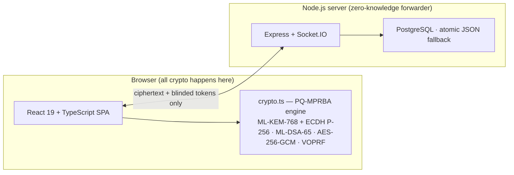

# PQ-MPRBA

**PQ-MPRBA** *(Post-Quantum Multi-Party Ratchet with Blinded Authentication)* — the post-quantum encryption protocol behind my end-to-end encrypted messenger.

PQ-MPRBA was designed by Mohammad Taha Azizi Ahad.

## What it is

A messaging encryption protocol built for the browser, designed around one idea: every part of the conversation — the keys, the identities, the group membership — has to survive both today's attackers and tomorrow's quantum computers.

It has four layers:

1. **Hybrid post-quantum ratchet** — ML-KEM-768 + ECDH P-256 feeding HKDF-SHA256, with a fresh AES-256-GCM key per message. Forward secrecy and post-compromise recovery, with real RAM zeroization.
2. **Post-quantum identity signatures** — ML-DSA-65 signatures over identity bundles. A contact earns the PQ badge only with a valid key *and* a valid signature; forged signatures are called out, not silently accepted.
3. **Group key rotation** — a Group Epoch FSM (STABLE → ROTATING → STABLE) with a 3-epoch grace buffer, so membership changes never break in-flight messages and never leak past or future ones.
4. **Blinded authentication** — Ristretto255-VOPRF (RFC 9497), so the server can verify you without learning who you are. The server is a zero-knowledge forwarder: ciphertext and blinded tokens only, never plaintext.

## The engine

The whole protocol engine lives in a single file: [`crypto.ts`](crypto.ts) — Web Crypto API + `@noble/post-quantum` / `@noble/curves`, running entirely in the browser.

## Where it runs

The full messenger that uses this protocol: https://github.com/indirect-b/chat-app

## Spec

Read [`PROTOCOL.md`](PROTOCOL.md) for the full design: primitives, the ratchet, signatures, group epochs, blinded auth, and the honest limits.

## Writing about it

- [I built a post-quantum encrypted messenger in the browser — here's how it works](https://dev.to/indirectb/i-built-a-post-quantum-encrypted-messenger-in-the-browser-heres-how-it-works-241a)
- [Post-quantum messaging in the browser: why I added ML-DSA signatures to my messenger](https://dev.to/indirectb/post-quantum-messaging-in-the-browser-why-i-added-ml-dsa-signatures-to-my-messenger-10a8)

## Honest limits

PQ-MPRBA is experimental work by one person. It has **not** been independently audited. The design is hybrid — it still carries a classical ECDH half — and it is labeled as such on purpose. This repo exists so the design can be read, criticized, and improved in public.

## License

MIT — see [LICENSE](LICENSE). Copyright (c) 2026 indirect-b.

---

## درباره پروژه

PQ-MPRBA پروتکل رمزنگاری پساکوانتومی پیام‌رسان من است — طراحی‌شده توسط محمد طاها عزیزی. همه‌ی رمزنگاری داخل مرورگر انجام می‌شود و سرور فقط پیام‌های رمز‌شده را جابه‌جا می‌کند، بدون اینکه محتوای پیام‌ها را ببیند.
